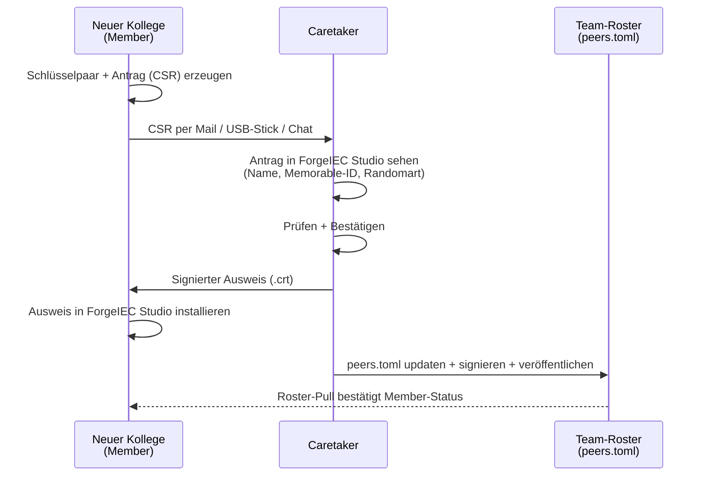

## Wofür brauche ich das?

Stellen Sie sich vor: zwei Programmierer sitzen an verschiedenen
Workstations und entwickeln am gleichen Anlagen-Projekt. Beide haben
ihren eigenen KI-Helfer. Es wäre praktisch wenn:

- Der KI-Helfer an Workstation A **die POUs an Workstation B sehen
  könnte**.
- Workstation B könnte einen **Code-Review von Workstation A's KI
  anfordern**.
- Eine zentrale Maschine (z.B. ein Build-Server) könnte den Code
  vorab compilieren bevor er auf die echte SPS geht.

Das nennen wir hier ein **Team**. Damit das funktioniert, braucht es
**Vertrauen** zwischen den Maschinen — kein wildfremdes Studio
soll auf Ihres zugreifen können, nur die Kollegen Ihrer Wahl.

---

## Wie funktioniert das Vertrauen?

ForgeIEC nutzt das gleiche Prinzip das auch Webbrowser nutzen:
**digitale Ausweise** (Zertifikate). Jede Workstation hat einen
Ausweis, und nur Ausweise die von einer **gemeinsamen vertrauten
Stelle** ausgestellt sind, werden akzeptiert.

Diese vertraute Stelle nennen wir den **Caretaker** — eine bestimmte
Workstation in Ihrem Team, die das Ausstellen und Zurückziehen der
Ausweise übernimmt. Quasi der „Pförtner".

Die drei Rollen im Team:

| Rolle | Was sie tut |
|---|---|
| **Caretaker** | Stellt Ausweise aus, zieht sie zurück. Eine Workstation in Ihrem Team — typischerweise die des Team-Leads oder eine zentrale Build-Maschine. |
| **Member** | Normale Workstations — bekommen ihren Ausweis vom Caretaker. Können Anfragen an andere Members stellen. |
| **Gast (nicht im Team)** | Wird abgelehnt — sieht Ihr Editor gar nicht. |

---

## Wie erkenne ich einen Ausweis?

Ein Ausweis-Fingerabdruck ist eine 64-Zeichen-lange Hex-Zahl:

> `ba:fc:ef:32:9d:5c:36:08:63:c5:47:d5:9f:c2:8b:92:...`

Diese **byteweise zu vergleichen** ist nicht praktikabel. ForgeIEC
gibt Ihnen deshalb **zwei zusätzliche Darstellungen** desselben
Fingerabdrucks:

### Merkfähiger Name (Memorable ID)

Vier englische Wörter, jedem Fingerabdruck eindeutig zugeordnet:

> `road-trash-smile-deny`

Das ist **mündlich verifizierbar** ("Sag mir am Telefon den
Memorable-ID deiner Workstation"). Schon ein einziges verändertes
Bit am Anfang des Fingerabdrucks schiebt **alle vier Wörter**
komplett — Fälschungen fallen also sofort auf.

### Bild-Darstellung (Randomart)

Ein kleines ASCII-Bild, einzigartig pro Fingerabdruck:

```
+----[SHA256]-----+
|        o. ..... |
|       o .o .   .|
|      o  ....   o|
|.    . .+.   o ..|
| + .. ..Soo.. o  |
|. +. . . +.++.   |
| oo   o .oo+..   |
|...= o +o.+      |
|E+*o. +.o=o      |
+-----------------+
```

Sie lernen die **Form** des Bildes Ihrer Kollegen nach 2-3
Begegnungen wieder. Ein veränderter Fingerabdruck sieht **deutlich
anders aus**.

> **In der Praxis:** Beim Aufnehmen eines neuen Kollegen ins Team
> zeigt Ihnen der Caretaker beides nebeneinander — Name + Bild.
> Sie bestätigen wenn beide zur Person passen die da gerade
> beitreten will. Quasi eine **digitale Personalausweis-Kontrolle**.

---

## Ein neuer Kollege wird ins Team aufgenommen



So läuft das ab — aus Ihrer Sicht als Operator:

**1. Der neue Kollege bereitet einen Ausweis-Antrag vor.**
Sein ForgeIEC Studio erzeugt ein Schlüsselpaar und einen
Antrag (CSR). Den Antrag schickt er Ihnen (Caretaker) per
Mail / USB-Stick / Chat.

**2. Sie als Caretaker sehen den Antrag in Ihrem Editor.**
Ihr Editor zeigt:
- Subject (`alice@MeinTeam`)
- Memorable-ID des **noch nicht ausgestellten** Ausweises
- Randomart davon

**3. Sie bestätigen** wenn die Daten passen — der Caretaker stellt
den Ausweis aus und schickt ihn dem Kollegen zurück.

**4. Der Kollege installiert den Ausweis** in seinem Editor und ist
ab da Member.

**5. Sie veröffentlichen die aktualisierte `peers.toml`** — die
Datei in der alle Team-Mitglieder mit ihren Ausweis-Fingerabdrücken
gelistet sind. Verteilung per Git, geteiltes Laufwerk, USB,
gemeinsamer Sharepoint — egal, denn die Datei ist **digital
signiert**. Eine unterwegs veränderte Kopie wird vom Editor
**abgelehnt**.

---

## Einen Kollegen aus dem Team entfernen

Wenn ein Kollege wechselt, ein Notebook verliert oder ein
Ausweis kompromittiert wird:

1. Sie als Caretaker **widerrufen** den Ausweis — Editor trägt
   ihn in eine `revoked.toml`-Liste ein, signiert sie, veröffentlicht.
2. Alle anderen Team-Mitglieder ziehen die Liste alle paar Minuten
   und ablehnen den widerrufenen Ausweis ab dann **sofort**.

**Hinweis (Stand 2026-05):** Das eigentliche Schreiben der
`revoked.toml`-Liste ist die letzte offene Teilaufgabe — bis dahin
machen Sie das per Hand:

- Editor stoppen
- `revoked.toml` editieren, neue Zeile mit dem Fingerabdruck +
  Begründung anhängen, `sequence_number` um 1 erhöhen
- Re-signieren mit dem Caretaker-Schlüssel (Befehl wird in einer
  späteren Doku ergänzt sobald das Werkzeug fertig ist)

Sobald `team.revoke_peer` in ForgeIEC Studio verfügbar ist, läuft das vollständig über die UI.

---

## Voraussetzungen für Team-Mode

- Beide Editoren sind **freigeschaltet** (siehe
  [Sicherheits-Modell](/help/ai/security/))
- Eine Workstation ist als **Caretaker** konfiguriert. In den
  Preferences gibt es dafür einen extra Schritt — Sie müssen
  exakt den Satz **„I accept Team-CA responsibility"** eingeben
  bevor der Caretaker-Modus an ist. Das ist Absicht: ein Caretaker
  hält die Vertrauenskette des ganzen Teams in der Hand.
- Beide Workstations können sich **gegenseitig per Netzwerk
  erreichen** (offener Port, Firewall-Regel — die Adressen stehen
  in `peers.toml`).

---

## Weiter

- [Sicherheits-Modell](/help/ai/security/) — was bedeutet
  "freigeschaltet"
- [Personas](/help/ai/agents/) — wer darf was im Team
- [Zurück zur AI-Übersicht](/help/ai/)
