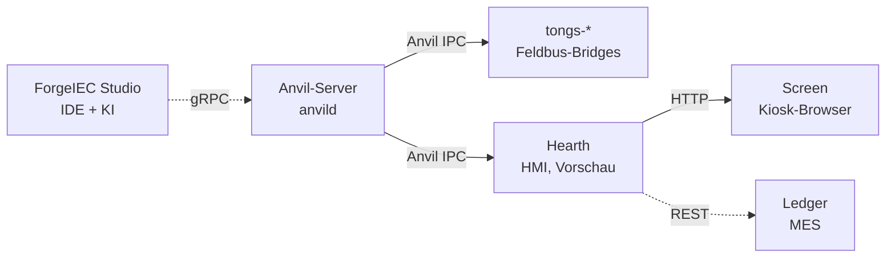

> **Neu hier?** [Der ForgeIEC-Verbund](verbund/) erklärt das Ganze in einem
> Zug: das Bild, die Begriffe, die drei Wege und die Fallen — der Einstieg,
> bevor die Einzelseiten unten Sinn ergeben.

## Was die Plattform leistet

ForgeIEC ist eine vollständige Plattform für industrielle
Automatisierung — von der Programmierung bis zur Bedienung. Aktueller
Stand: **Vorabversion 0.2** (0.2.2); im Pilotbetrieb bei der SoLaWi Ackervielfalt.
Jede
Komponente trägt den Namen eines Schmiedewerkzeugs und hat einen
klar umrissenen Auftrag. Komponenten sind eigenständige Daemonen
bzw. Anwendungen, gemeinsam laufen sie über Zero-Copy-IPC und
gRPC.

| | Komponente | Auftrag | Stand |
|:---:|---|---|---|
|    | **ForgeIEC Studio** | IEC-61131-3-IDE + Bus-Konfig + KI-Helfer | ST-Editor , LD/FBD/SFC  |
|    | **Anvil-Server (anvild)** | SPS-Runtime + Anvil-Bus (iceoryx2) zwischen den Prozessen |  |
|     | **tongs-***         | Feldbus-Bridges: Modbus TCP/RTU verfügbar, LoRaWAN in Arbeit (Schwerpunkt), EtherCAT / PROFIBUS / EtherNet/IP als Gerüst |  |
|    | **Hearth**          | Bedienoberfläche (HMI), liest die Prozessdaten direkt vom Anvil-Bus |  |
|    | **Screen**          | Industrieller Kiosk-Browser (Bedienpanel) |  |
|  | **bellowsd**        | OPC-UA- / HMI-Gateway |  |
|    | **Ledger**          | Auftragsverwaltung / MES-Integration |  |

---

## Die Komponenten

### 🛠️ ForgeIEC Studio — die Werkbank



Native C++/Qt6-IDE auf der Workstation (Linux; ein Windows-Build
existiert, Installer auf Anfrage). Strukturierter Text (ST) mit
eigenem, objektorientierungsfähigem Compiler-Kern ist im Einsatz;
LD, FBD und SFC sind für die Releases 0.3, 0.4 und 0.5 geplant
([Roadmap](/de/roadmap/)), IL ist abgekündigt.
Bus-Konfiguration, Live-Monitor,
Oszilloskop, KI-Helfer eingebaut. Tree-sitter-basierte Syntax,
gRPC-Anbindung an anvild, MCP-Server für LLM-Tooling.

[Mehr erfahren](forge-studio/)

### 🔥 Anvil-Server (anvild) — die Runtime + Anvil-Bus



Rust/Tokio-Daemon auf der Ziel-SPS. Multi-Task-Scheduler mit
pthread-Parallelität, deterministische Scan-Cycles, gRPC-Listener
für das Studio, Subprozess-Manager für die Bus-Bridges.

Eingebaut ist **Anvil** — der Anvil-Bus, eine Zero-Copy-Shared-Memory-Schicht auf Basis von iceoryx2,
zwischen Runtime, Bridges und externen Subscribern. ABI-Probe gegen
Type-Hash-Drift; Segmente abgestürzter Peers werden automatisch
zurückgeholt, ohne lebende Peers anzutasten. Wire-Protokoll für
Status, I/O, Diagnostik.

[Mehr erfahren](anvil/)

### 🌬️ bellowsd — der Blasebalg




bellowsd ist derzeit **nicht in Entwicklung**. Das Paket
`forgeiec-bellows-server` bleibt im APT-Repository, wird aber nicht
weiterentwickelt. Für die Bedienung ist Hearth vorgesehen.


Ausgelegt als OPC-UA-Server + Modbus-TCP-Server für die HMI-Anbindung:
Pool-Variablen mit `bellows_export`-Flag als OPC-UA-Knoten +
Modbus-Coils, pro Variable einzeln freigegeben.

[Mehr erfahren](bellows/)

### 🔧 tongs-* — die Feldbus-Zangen



Pro Protokoll ein eigener Daemon. Einheitliches Fault-Modell
(`OK/WARN/FAULT/OFFLINE/UNKNOWN`), FDD-getriebene Diagnose-Bits,
Anvil-Zero-Copy-IPC zur Runtime. Modbus TCP und Modbus RTU sind
verfügbar; LoRaWAN (Funk-Sensorik für Landwirtschaft und weitläufige
Anlagen) ist in Arbeit und hat Vorrang; für EtherCAT, PROFIBUS und
EtherNet/IP steht das Gerüst, das Protokoll selbst ist in Arbeit.

[Mehr erfahren](tongs/)

### 🖥️ Screen — der Kiosk-Browser



CEF-basierter Industrie-Kiosk-Browser (Chromium Embedded Framework
+ Rust + winit). Läuft fullscreen auf Bedienpanels, öffnet eine
beliebige Web-HMI (Hearth oder Fremd-HMI). Integrierter
Rocket-Web-Server für Settings (Netz, WireGuard, Zeitzone,
80+ Sprachen), D-Bus-Backend für NetworkManager / timedated /
localed.

[Mehr erfahren](screen/)

### 🏠 Hearth — der Herd



Bedienoberfläche (HMI), als Vorschau. Hearth liest die Prozessdaten
direkt vom Anvil-Bus (iceoryx2, ohne Kopie) — denselben Weg, den die
Runtime intern nutzt; anvild legt den passenden Descriptor unter
`/etc/forgeiec/hearth/descriptor.toml` ab. Als Paket
`forgeiec-hearth-server` im APT- und RPM-Repository verfügbar.

[Mehr erfahren](hearth/)

### 📒 Ledger — das Auftragsbuch



Auftragsverwaltung + MES-Integration. Plant: Produktionsaufträge,
Stückzahl-Tracking, Rückverfolgbarkeit (Material → Charge →
Produkt), Schichtbuch, Brücke zu ERP-Systemen. In Planung — kommt
nach Hearth.

[Mehr erfahren](ledger/)

---

## Wie die Komponenten zusammenspielen

Studio sitzt auf der Workstation, alles andere auf den Ziel-
Systemen. Workstations + Ziel-Systeme können über das
[Team-Federation-Modell](/de/news/federation-team-trust/) miteinander
verbunden werden — mehrere Workstations sehen ihre Anlagen.

---

## Lizenz, Quellcode und Herkunft

**Lizenz.** Die Werkzeuge und Dienste von ForgeIEC stehen unter
AGPL-3.0-or-later. **Ihr Projekt gehört Ihnen**: der generierte
Steuerungscode, die Runtime-API-Header und die Bibliothek libanvil
stehen unter Apache-2.0 — Sie dürfen darauf eigene, geschlossene
Bibliotheken bauen. Wer die AGPL nicht akzeptieren kann, erhält eine
kommerzielle Lizenz.

Der Quellcode steht unter der AGPL; Einsicht auf Anfrage
(Freischaltung per SSH-Schlüssel, siehe [Partner](/de/partner/)).
Ausgeliefert wird über signierte Pakete aus einer automatisierten
CI: ein signiertes APT-Repository für Debian/Ubuntu und ein
signiertes RPM-Repository für AlmaLinux 9 und Fedora 44.

ForgeIEC begann als Fork von **OpenPLC** (Thiago Alves); der
matiec-Compiler wurde durch einen eigenen, objektorientierungsfähigen
Kern ersetzt. Die [Gründungsgeschichte](/de/news/die-forgeiec-geschichte/)
erzählt den Weg.

---

**Die Werkzeuge der Schmiede.**

blacksmith@forgeiec.io

