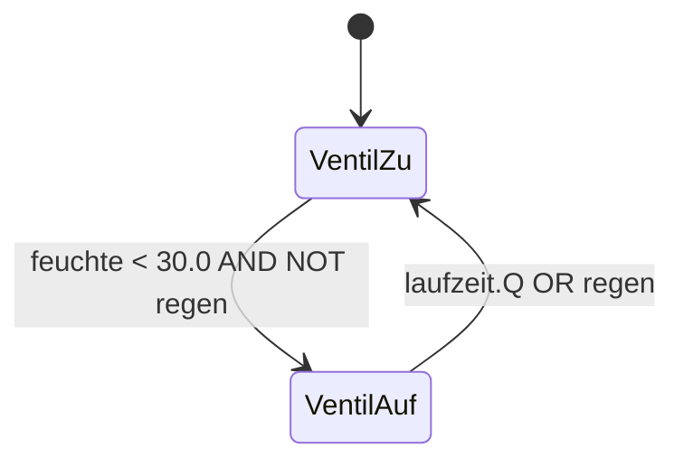

## Die Werkbank

Forge Studio ist die integrierte Entwicklungsumgebung der ForgeIEC-Plattform.
Hier entsteht das SPS-Programm — vom ersten Entwurf bis zum fertigen Projekt.
Wie die Werkbank in der Schmiede bietet Forge Studio alle Werkzeuge in
Griffweite: Editor, Compiler, Debugger und Bussystem-Konfiguration in
einer Anwendung.

---

## IEC 61131-3: ST heute, eine Sprache je Release

Strukturierter Text ist im produktiven Einsatz (Pilotbetrieb, Release
0.2). Je Release kommt eine Sprache hinzu: **0.3 LD, 0.4 FBD, 0.5
SFC**. Programme in diesen Sprachen werden derzeit **noch nicht
übersetzt**. AWL (Anweisungsliste) wurde mit der dritten Ausgabe der IEC 61131-3 (2013) abgekündigt und ist in der aktuellen Ausgabe, IEC 61131-3:2025 (erschienen im Mai 2025), nicht mehr enthalten. ForgeIEC entwickelt sie nicht; sie bräuchte außerdem einen eigenen Übersetzungsweg nach Assembler.
<!-- ENTWURF: Annex B der Norm einsehen, bevor es als Normaussage zitiert wird -->
Siehe [Roadmap](/de/roadmap/).

- **Strukturierter Text (ST)** —  Hochsprache mit Syntax-Hervorhebung,
  Auto-Vervollständigung und Tree-sitter-basiertem Parsing; eigener
  Compiler-Kern, der auch die objektorientierten Erweiterungen
  (METHOD, INTERFACE, EXTENDS) beherrscht
- **Kontaktplan (KOP/LD)** —  Vertraute Darstellung für Schaltlogik,
  direkt am Bildschirm verdrahten
- **Funktionsbausteindiagramm (FBS/FBD)** —  Grafischer Editor mit
  Baustein-Bibliothek und Drag-and-Drop
- **Ablaufsprache (AS/SFC)** —  Schrittkettendiagramme für
  Sequenzsteuerungen mit Transitionen und Aktionen
- **Anweisungsliste (AWL/IL)** —  wird nicht weiterentwickelt
  und nicht übersetzt

---

## Dokumentation im Projekt {#dokumentation}

Die Dokumentation lebt im Projekt. Jede POU, jede Variable und jeder Datentyp trägt ihre eigene Beschreibung als Markdown, gespeichert in derselben PLCopen-XML-Datei wie das Programm. Was im Code steht, wird mit dem Code versioniert, kopiert und ausgeliefert, ohne Nebendokument, das veraltet. Beim Import von Structured Text übernimmt ForgeIEC Ihre vorhandenen `(* … *)`-Kommentare gleich als Dokumentation.

Gespeichert wird nach IEC 61131-10 / PLCopen TC6: `<documentation><xhtml>` am jeweiligen Knoten, die Projektbeschreibung in `<contentHeader><Comment>`. Variablen tragen neben der Dokumentation eine HMI-Beschriftung und ein BMK nach IEC 81346, bis hinunter zum einzelnen Array-Element. Alle Texte sind über die MCP-Schnittstelle lesbar, so dass ein KI-Assistent, auch ein lokal betriebenes Modell, die Doku mitlesen kann.

Aus Structured Text erzeugt ForgeIEC auf Anfrage ein Ablaufdiagramm im Mermaid-Format, das der KI-Assistent lesen und Ihnen zeigen kann.

Der KI-Assistent (Persona „Doc“) liest das Projekt und schlägt Markdown-Dokumentation vor; er läuft auch mit einem lokalen Modell (LM Studio oder jeder OpenAI-kompatible Endpunkt).
<!-- ENTWURF: stimmt erst voll nach Behebung der Studio-Issues D-1 bis D-3 -->

<figure class="figure">

<figcaption>Beispiel: So sieht ein Ablaufdiagramm im Format <code>stateDiagram-v2</code> aus, hier für das Bewässerungsprogramm von der Startseite. Von Hand geschrieben zur Veranschaulichung, keine Ausgabe des Studios; dargestellt mit dem Mermaid dieser Website.</figcaption>
</figure>









---

## Syntax-Hervorhebung mit Tree-sitter

Forge Studio verwendet Tree-sitter für inkrementelles Parsing des
Quellcodes. Das bedeutet:

- Präzise Syntax-Hervorhebung auch bei unvollständigem Code
- Strukturelles Verständnis des Programms während der Eingabe
- Schnelle Navigation zwischen Deklarationen und Referenzen
- Keine regulären Ausdrücke — echte Grammatik

---

## Bussystem-Integration

Die an etablierten IEC-61131-3-IDEs orientierte Bussystem-Verwaltung
ist direkt in die Entwicklungsumgebung integriert:

- Segment-Hierarchie mit Geräten und Variablen im Projektbaum
- Automatische IEC-Adressvergabe ohne Kollisionen
- Netzwerk-Scanner für Geräteerkennung
- Diff-Ansicht bei Änderungen zwischen Editor und Laufzeitsystem
- Automatische Generierung der VAR_ANVIL-Transportschicht

---

## Verbindung zur Laufzeitumgebung

Forge Studio kommuniziert über gRPC mit dem Anvil-Server (anvild):

- **Übersetzung in zwei Stufen** — das Studio übersetzt IEC-Code in
  C++-Quelltext und schickt ihn verschlüsselt an die Steuerung; dort
  baut die Runtime ihn mit g++ — die Steuerung braucht also `make`
  und `g++`, aber keinen IEC-Compiler
- **Verschlüsselter Upload** — AES-256-GCM-verschlüsselte Übertragung
  auf das Zielsystem
- **Live-Debugging** — Variablen in Echtzeit beobachten und forcieren
  während die SPS läuft
- **Benutzerverwaltung** — Mehrbenutzerbetrieb mit Rechtesystem und
  First-Login-Workflow nach Industrie-Standard

---

## Standardbibliothek

Vollständige IEC-Standardbibliothek in einer SQLite-Datenbank:

- Zähler (CTU, CTD, CTUD)
- Timer (TON, TOF, TP)
- Flankenbausteine (R_TRIG, F_TRIG)
- Bistabile Elemente (SR, RS)
- Typkonvertierungen und mathematische Funktionen
- Erweiterbar durch benutzerdefinierte Bausteine

---

## Technische Eckdaten

| Eigenschaft | Wert |
|-------------|------|
| **Sprache** | C++17 |
| **GUI-Framework** | Qt 6 Widgets |
| **Syntax-Engine** | Tree-sitter |
| **Kommunikation** | gRPC (protobuf) |
| **Plattformen** | Linux x86_64/ARM64, Windows x64 (Installer auf Anfrage) |
| **Lizenz** | AGPL-3.0-or-later (generierter Code: Apache-2.0) |

---

## Ansichten













**Forge Studio — Die Werkbank für industrielle Automatisierung.**

blacksmith@forgeiec.io

