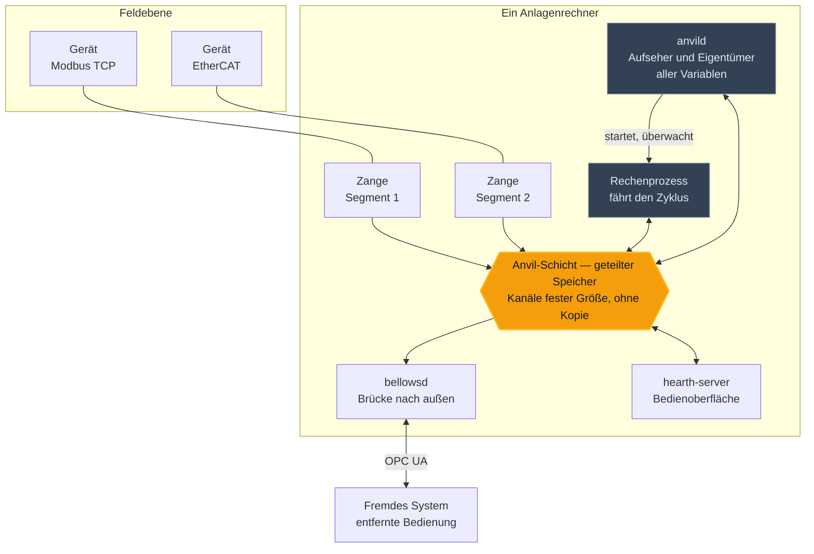
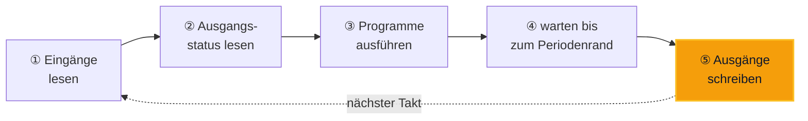
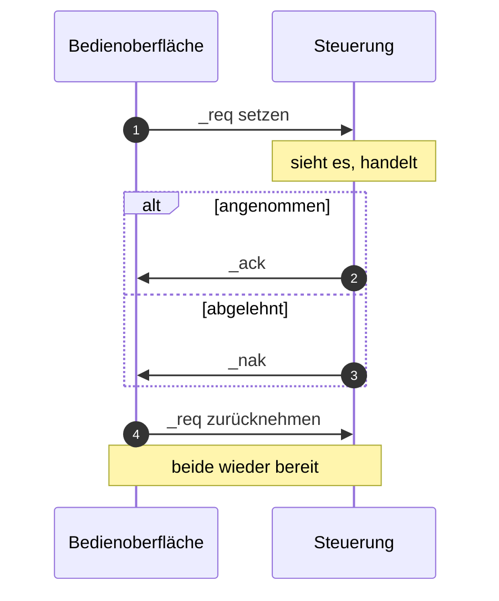
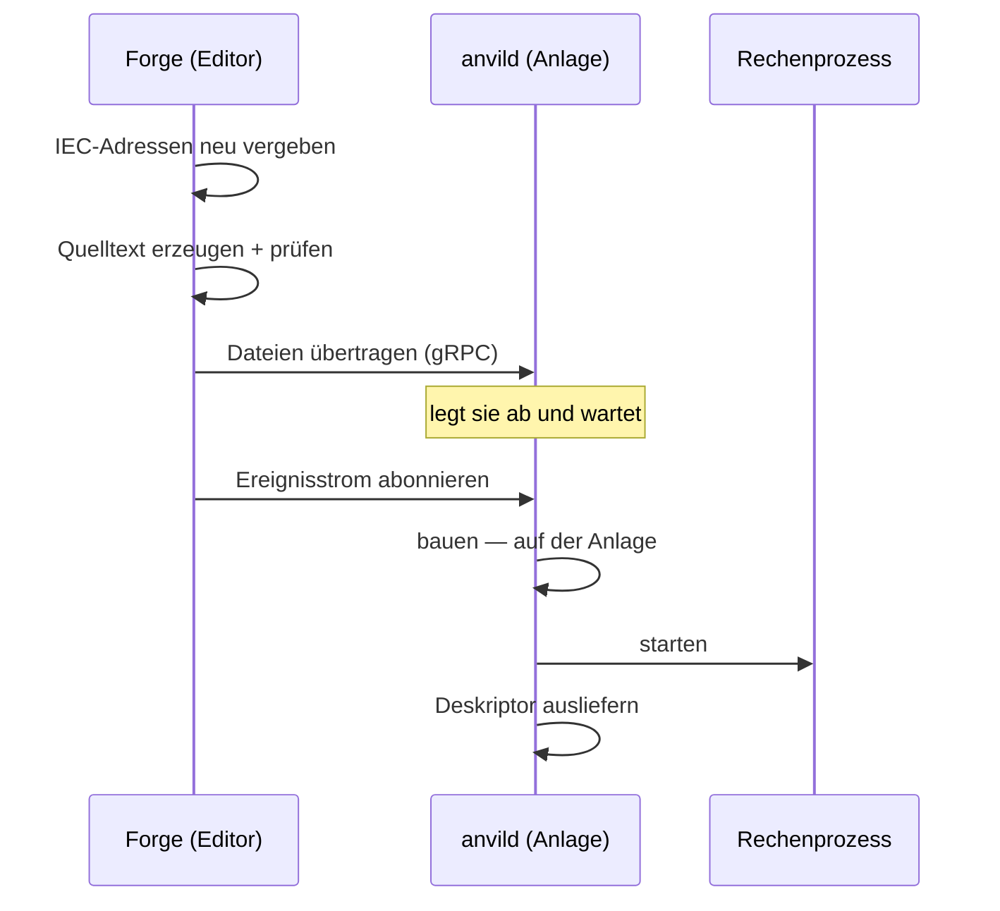
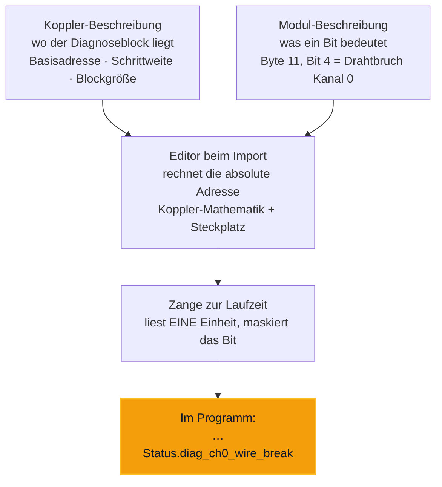

## Sechs Programme, drei Wege, ein Takt

*Und ein Dutzend Wörter, die man kennen muss, bevor irgendetwas davon Sinn ergibt.*

Diese Seite ist der **Einstieg**: das Bild, die Begriffe, die Faustregeln und die
Fallen. Sie erzählt die Fachpapiere nicht nach — wo eine Festlegung verbindlich ist,
nennt sie das Papier, in dem sie steht. So gibt es für jede Aussage genau einen Ort,
an dem sie geändert wird.

1. [Die Werkstatt](#werkstatt)
2. [Das Bild](#bild)
3. [Der Takt](#takt)
4. [Wem die Daten gehören](#eigentum)
5. [Drei Wege](#wege)
6. [Der Deskriptor](#deskriptor)
7. [Ein Befehl](#befehl)
8. [Vom Entwurf zur Anlage](#anlage)
9. [Bus und Geräte](#bus)
10. [Wenn etwas ausfällt](#ausfall)
11. [Das Wort „Anvil“](#anvil)
12. [Eine Zange bauen](#zange)
13. [Zeit und Vertrauen](#zeit)
14. [Die Papiere](#papiere)

---

## 01 · Die Werkstatt {#werkstatt}

Die Namen sind kein Zufall. Der Verbund ist eine Schmiede, und jeder Teil heisst nach
dem Werkzeug, dessen Arbeit er tut.

| Teil | Rolle | Auftrag |
|---|---|---|
| **Forge** | Entwurf | Die Entwicklungsumgebung. Hier entstehen Steuerungsprogramm, Variablen, Datentypen und die Bustopologie. |
| **Anvil** | Laufzeit · Amboss | Wo geschlagen wird: die Steuerungslaufzeit auf dem Anlagenrechner — Aufseher, Rechenprozess und der Speicher dazwischen. |
| **Tongs** | Verbinder · Zange | Fasst an, was heiss ist: die Hardware. Ein Prozess je Bussegment, je Feldbusprotokoll eine eigene Zange. |
| **Bellows** | Brücke · Blasebalg | Bringt Luft von aussen herein. Fremde Systeme holen Werte über OPC UA oder Modbus TCP. |
| **Hearth** | Bedienung · Feuerstelle | Wo der Mensch steht. Anlagenbilder, Werte, Bedienelemente. |
| **Spark** | Weg · Funke | Springt über: der Weg zwischen Rechnern, wenn eine Anlage nicht auf einem Knoten läuft. |

---

## 02 · Das Bild {#bild}

Alles läuft als eigenes Programm nebeneinander auf einem Rechner — und redet über
einen Speicher, den alle sehen.



Die Zangen reden nach unten mit der Hardware und legen nach oben ab. Bellows und
Hearth lesen. Niemand kopiert etwas: alle greifen auf denselben Speicher.


**`anvild` rechnet nicht.** Es ist *Aufseher* — es startet den Rechenprozess,
überwacht ihn, startet ihn nach einem Absturz neu und besitzt den Variablenspeicher.
Der Zyklus läuft in einem **eigenen Prozess** daneben.

Das ist keine Feinheit: es erklärt, warum ein abgestürztes Anwenderprogramm die Werte
nicht mitnimmt, und warum ein Programmwechsel möglich ist, ohne dass die Anlage ihren
Zustand verliert.



Weil der Takt wartet. Serialisieren, senden, entpacken kostet mehr Zeit, als zwischen
zwei Schlägen übrig ist. Der gepackte Datenblock ist deshalb kein Provisorium, das
später durch etwas Allgemeineres ersetzt wird. Er *ist* die Antwort.


---

## 03 · Der Takt {#takt}

Eine Steuerung rechnet nicht, wenn etwas passiert. Sie rechnet immer — in festen
Abständen, ob sich etwas geändert hat oder nicht.

Die Ordnung stammt aus der Norm IEC 61131-3 und ist vier Stufen tief:

```text
Konfiguration
  └── Resource            eine Rechenressource
        └── Task          ← die Taktgeberin: trägt die Zykluszeit
              ├── Programm A   \  laufen je Zyklus
              └── Programm B   /  nacheinander, in fester Reihenfolge
```

Die **Task** ist die kleinste Einheit, die zyklisch läuft. Sie trägt die Zykluszeit;
Programme sind das, was *innerhalb* eines Takts abgearbeitet wird. Ein einzelnes
Programm bekommt nur dann eine eigene Rate, wenn es allein in einer Task liegt. Tasks
sind unabhängig voneinander, jede in eigenem Strang.



Fünf Phasen. Die Pointe steht am Ende: **die Ausgänge werden am Periodenrand
geschrieben**, nie mittendrin. Damit ist der Zeitpunkt, zu dem die Anlage sich bewegt,
gleichmäßig — unabhängig davon, ob die Rechnung diesmal schnell oder langsam war.

Gewartet wird nicht in einer Schleife, sondern mit zwei Zeitgebern: einer startet den
Zyklus, der zweite liegt genau auf dem Periodenrand. Eine selbstgebaute Warteschleife
würde Rechenzeit verbrennen und Drift einbauen.


Der Zyklus wird **nicht gedehnt**. Der zweite Zeitgeber setzt ein Fehlerbit und
rastert den Takt neu. Gezählt werden Jitter, Überläufe und verpasste Fristen — in
einem eigenen Strang, nie im heißen Pfad.

Eine Steuerung, die „nur ein bisschen zu langsam“ ist, gibt es also nicht. Sie hält
den Takt oder sie meldet, dass sie ihn verfehlt hat.


### Zweimal so schnell abtasten, oder gar nicht

Wer eine Anlage seltener abfragt, als sie sich ändert, sieht Bewegungen, die es nicht
gibt — derselbe Effekt, der im Film Wagenräder rückwärts laufen lässt. Deshalb muss
die Abfrageperiode am Bus höchstens halb so lang sein wie der Systemzyklus. Der
schnellste Strang bindet, und die Laufzeit verweigert sonst den Anlauf.

---

## 04 · Wem die Daten gehören {#eigentum}

Zwei Festlegungen, die zusammen erklären, warum ein Fremdhersteller überhaupt etwas
beisteuern darf.

### Alle globalen Variablen gehören dem Aufseher

Das Anwenderprogramm hält **keine eigene Kopie**. Es bekommt Zeiger auf den einen
echten Speicher und rechnet darin. Deshalb überlebt der Anlagenzustand den Austausch
des Programms — und deshalb kann ein abgestürzter Rechenprozess neu gestartet werden,
ohne dass die Werte verloren gehen.

### Es gibt genau zwei Arten anzudocken

| Grenze | Wer dort sitzt | Wie zugegriffen wird |
|---|---|---|
| **innen** | das Anwenderprogramm | rechnet *im* Speicher des Aufsehers — geschlossen, Erstanbieter |
| **außen** | Zangen und Bellows | tauschen **nur Datenpakete** über die Anvil-Schicht, nie Zugriff auf den Speicher des Aufsehers |


Ein Fremdhersteller kann eine Zange beisteuern, weil sie den Speicher der Steuerung
gar nicht erreichen *kann* — sie schickt Pakete und empfängt Pakete. Was drinnen
passiert, bleibt drinnen.


---

## 05 · Drei Wege, und wann welcher {#wege}

Die häufigste Entwurfsfrage im Verbund lautet: worüber schicke ich das? Sie lässt sich
ohne Nachschlagen beantworten.

| Weg | Wofür | Eigenschaft |
|---|---|---|
| **Anvil** | Prozessabbild *innerhalb* eines Rechners | geteilter Speicher, ohne Kopie, feste Größe |
| **Spark** | Prozessdaten *zwischen* Rechnern | über den Draht, mit Zertifikaten gesichert |
| **gRPC** | ein Werkzeug spricht mit einem Daemon | getippt, strömend, nicht zeitkritisch |


Gehört es zum Zyklus? → **Anvil**

Kommt es von einem Werkzeug? → **gRPC**

Geht es nach draußen oder von Daemon zu Daemon? → **der Bus**


Zwei Sätze halten das zusammen. Der erste: **auf beiden Seiten identische Wege** —
derselbe Kanal für dieselbe Aufgabe, gleich ob Forge oder Hearth ihn benutzt. Kein Weg
bedeutet hier das eine und dort das andere.

Der zweite: **die Automatisierungswelt bleibt unter sich.** Die Echtzeitebene verlässt
ihre eigenen Mittel nicht. OPC UA ist die *Grenze nach außen*, nicht der Kitt nach
innen.

---

## 06 · Der Deskriptor {#deskriptor}

Im geteilten Speicher liegt kein Text und kein JSON, sondern ein gepackter Block. Wer
ihn lesen will, muss wissen, welches Byte was bedeutet.

```text
Byte   0   1   2   3   4   5   6   7   8 …
       ├───┼───┼───┼───┴───┴───┴───┴───┤
       │ x │ h │ m │      Dauer        │
       └───┴───┴───┴───────────────────┘
         │   │   │           └── TIME,  Versatz 4, Größe 4
         │   │   └────────────── USINT, Versatz 2, Größe 1
         │   └────────────────── USINT, Versatz 1, Größe 1
         └────────────────────── BOOL,  Versatz 0, Bit 0
```

Diese Auskunft heisst **Deskriptor**: eine Liste, die je Feld Name, Typ, Versatz,
Größe und gegebenenfalls das Bit nennt. Ohne sie sind die Bytes bedeutungslos; mit ihr
ist das Lesen ein Zeiger und eine Addition.

Es fahren zwei verschiedene Ströme darüber, und sie werden gern verwechselt: die
**Prozesswerte**, die das Steuerungsprogramm führt, und der **Gerätestatus**, den die
Zangen melden. Gleicher Weg, verschiedene Absender, verschiedene Fragen.


**Die Größe ist Teil der Identität.** Zwei Programme, die denselben Kanal mit
unterschiedlicher Größe öffnen, finden nicht zueinander — sie bekommen einen Typfehler
und fallen aus.

Das klingt unbequem und ist die eigentliche Absicherung: so kann niemand versehentlich
ein *anderes* Byteschema lesen und plausible, falsche Zahlen anzeigen. Ein Ausfall ist
auffindbar. Eine falsche Zahl ist es nicht.


---

## 07 · Ein Befehl ist kein Schreibvorgang {#befehl}

Einen Wert in den Speicher zu schreiben hat keine Empfangsbestätigung. Für eine
Anzeige ist das gleichgültig. Für einen Befehl ist es das Gegenteil.

Wer einen Knopf drückt, muss *„die Steuerung hat es getan“* von *„die Steuerung hat es
nie gesehen“* unterscheiden können. Ein Knopf, der still nichts tut, ist der
schlimmste Fall. Deshalb ist ein Befehl ein Ablauf:



Vier Phasen. Die drei Bits stehen im Deskriptor als solche gekennzeichnet, damit sie
niemand für gewöhnliche Variablen hält und in einer Bedienoberfläche anzeigt.

| Art | Verhalten | Beispiel |
|---|---|---|
| **Puls** | `_req` fällt nach der Quittung sofort zurück | ein Taster |
| **Auswahl** | `_req` bleibt stehen — der gehaltene Pegel *ist* die Auswahl | ein Betriebsartenschalter |

Bei der Auswahl braucht die Steuerung deshalb keinen eigenen Speicher: sie liest, was
ansteht. Umgesetzt ist der Ablauf **einmal**, in einer Bibliothek, die beide Seiten
binden — damit das Verhalten zwischen ihnen nicht auseinanderlaufen kann.

---

## 08 · Vom Entwurf zur laufenden Anlage {#anlage}

Was passiert, wenn jemand „übersetzen“ drückt — und wie das Ergebnis auf die Maschine
kommt.

| Wort | Was es tut |
|---|---|
| **generate** | nur erzeugen: aus dem Projekt werden Quelltextdateien. Kein Compiler läuft. |
| **compile** | erzeugen *und prüfen* — Namen auflösen, Typen prüfen, ein Gate, das Fehler blockt |
| **deploy** | die ganze Kette: übersetzen → hochladen → *auf der Anlage* bauen → starten |



Kein Dateikopieren, kein Paket: die *Quelltexte* gehen über den Draht, und gebaut wird
dort, wo es läuft. Der Bau beginnt erst, wenn der Editor den Ereignisstrom abonniert
hat — ein Handschlag, damit niemand einen Bau anstößt, dessen Ausgang er nicht sieht.

Am Ende dieses Wegs entsteht auch die **Decode-Karte** — der Deskriptor aus Abschnitt
06. Die Laufzeit ergänzt ihn um die Quittungs-Bits und legt ihn dort ab, wo die
Bedienoberfläche ihn findet. Deshalb passen Bytes und Bedeutung immer zu *demselben*
Bau.


Der Weg nimmt den Textkörper einer Programmeinheit. Grafische Sprachen werden vorher
*ausdrücklich* nach Strukturiertem Text umgeschaltet — das ist eine Handlung des
Anwenders, kein stiller Zwischenschritt beim Übersetzen.



**Ein Deploy, der eine Adresse verschiebt, macht genau eine Anzeige stumm.** Die
Beobachtung liest ihre Karte einmal je Strom, nicht je Auslieferung. Verschiebt sich
eine Adresse, bleibt *diese eine* Variable auf „leer“, während die Nachbarn munter
weiterlaufen.

Pflicht nach jedem Deploy: den Beobachtungsstrom neu öffnen. Eine einzelne tote
Anzeige zwischen lauter lebenden sucht man sonst an der falschen Stelle.


---

## 09 · Bus, Geräte und Gerätebeschreibungen {#bus}

Wie aus einem Stück Hardware im Schaltschrank ein Name im Steuerungsprogramm wird.

| Begriff | Was es ist |
|---|---|
| **Bussegment** | eine Bus-Instanz — ein Modbus-TCP-Master, ein EtherCAT-Strang. Eigenes Protokoll, **genau eine** Zange. |
| **Gerät** | ein Teilnehmer auf einem Segment. Schlüssel ist eine Kennung, die das Umbenennen überlebt. |
| **Modul** | eine Baugruppe, die in ein Koppler-Gerät gesteckt ist — mit ihrem Steckplatz. Kompaktgeräte haben keine. |

### Die Gerätebeschreibung

Zu jedem Gerät gehört eine **FDD** — eine Beschreibungsdatei des Herstellers. Darin
stehen Identität, Kommunikationsprofile, die Datenpunkte mit Typ und Richtung, die
Diagnosefelder und beim Koppler die Rechenvorschrift für den Diagnoseblock. Der Editor
liest sie beim Katalogimport; **die Zange liest sie nie** — sie bekommt fertig
aufgelöste Adressen.

**Adressen werden gerechnet, nicht importiert.** Wer ein Modul in einen Steckplatz
setzt, bekommt die Variablen und ihre Adressen automatisch. Eine von Hand gesetzte
Adresse wird als *gesperrt* vermerkt und bei keiner Neuvergabe überschrieben.

### Wie aus einem Registerbit eine Aussage wird



Vier Stufen, und der Grundsatz dahinter ist der wichtigste Satz des ganzen Bussystems.


**Weder das Steuerungsprogramm noch der Editor noch die Zange enthalten fest
verdrahtete Herstellerkonstanten.**

Das Wissen des Herstellers lebt in der Datei des Herstellers — und nur dort. Deshalb
kommt ein neues Fabrikat hinzu, *ohne dass jemand Code ändert*.


---

## 10 · Wenn etwas ausfällt {#ausfall}

Ein Gerät ist nicht einfach da oder weg. Es gibt zehn Zustände, und zwei davon werden
regelmäßig verwechselt.

| Zustand | Was los ist | Für die Steuerung |
|---|---|---|
| **Degraded** | Das Gerät **antwortet**, aber ein Teil der Werte schlägt fehl — teilweise blind. | verdächtig behandeln |
| **Unreachable** | Der **Transportweg** ist weg: Verbindung abgelehnt, Namensauflösung fehlgeschlagen, Link aus. | als offline behandeln |

Kurzform: *Degraded = teilweise blind, aber verbunden. Unreachable = gar keine
Verbindung.* Dazwischen liegen die Zustände des Auf- und Abbaus — Verbinden, Wartezeit
nach Fehlschlag, abgeschaltet, heruntergefahren.


Für Verriegelungen gibt es zwei bequeme Ableitungen — „läuft“ und „gestört“. Sie
schließen sich aus, aber **sie decken nicht alles ab**: beim Verbinden, im
abgeschalteten Zustand und beim Herunterfahren sind *beide falsch*.

Wer nur auf „gestört“ verriegelt, verriegelt beim Hochlaufen nicht. Beide
ausdrücklich prüfen.


Dazu ein Lebenszeichen: bewegt sich der Zeitstempel eines Segments über mehrere
Perioden nicht, gelten **alle** Geräte dieses Segments als offline — denn dann
schweigt nicht die Hardware, sondern die Zange.

---

## 11 · Das Wort „Anvil“ bedeutet vier Dinge {#anvil}

Der häufigste Anfangsfehler. Er kostet keinen Nachmittag, sondern einen falschen
Entwurf.

| Verwendung | Was gemeint ist |
|---|---|
| **die Anvil-Schicht** | der Weg: geteilter Speicher zwischen Prozessen *eines* Rechners |
| **Anvil als Erzeugnis** | die Laufzeit auf dem Anlagenrechner samt ihren Zangen |
| **die `anvil`-Bibliothek** | der Quelltext, der die Schicht umsetzt — für Rust und für C++ |
| **`ANVIL.<Gerät>.<Name>`** | etwas ganz anderes: ein **Namensraum für Variablen**, die entstehen, weil ein Gerät am Bus hängt |


Der letzte ist die gefährliche Bedeutung. *„Anvil liefert die Werte“* kann die
Speicherschicht meinen — oder die hardwaregebundenen Variablen. Zwei völlig
verschiedene Aussagen im selben Satz.



Daran hängt mehr als an allem anderen im Verbund.

Der *Weg* ist, wie Bytes von A nach B kommen. Die *Bedeutung* ist, was sie besagen —
welches Byte welcher Wert ist, welche Nummer welche Nachricht, in welcher Reihenfolge
quittiert wird.

**Anvil war nie die Bedeutung, immer nur der Weg.** Deshalb kann ein Kanal ersetzt
werden, ohne dass seine Bedeutung mit ihm verschwindet — und deshalb muss ein
Nachfolger sie *mitbringen*.


---

## 12 · Eine Zange bauen {#zange}

Für den, der von außen ein Feldbusprotokoll beisteuert.

Die Laufzeit **startet** Ihre Zange als eigenen Prozess und gibt ihr zwei Angaben mit:
welche Konfigurationsdatei und welches Segment daraus. Ihre Zange redet nach unten mit
der Hardware und legt nach oben **einen** Block ab — den Zustand aller Geräte ihres
Segments. Mehr ist es nicht.

### Sie lauscht nirgends

Ihre Zange belegt keinen Port und braucht keinen registriert. Der einzige Port, der in
einer Zange vorkommt, ist der des *fremden Geräts* — und der steht in der
Konfiguration, nicht in einer Spezifikation.

### Sie veröffentlicht je Segment, nicht je Gerät

Ein Segment, ein Prozess, ein Statuskanal; die Geräte stehen als Einträge *darin*.
Kanäle je Gerät sind untersagt — sie wären mehr Wege für dieselbe Aussage, und niemand
bekäme mehr einen Schnappschuss eines ganzen Buszyklus.

### Sie sucht sich nichts

Es gibt keine Entdeckung, weil das Elternteil weiss, wen es erzeugt hat. Das Kind
wählt nicht, es bekommt zugewiesen.

### Was Sie mitbringen müssen

- **Eine Zange** — aber nur, wenn Ihr *Protokoll* neu ist. Sie erfüllt eine einzige
  Schnittstelle: verbinden, trennen, lesen, schreiben, Zustand melden.
- **Eine Gerätebeschreibung je Gerät** — immer. Ohne sie entsteht ein leeres Gerät
  ohne Variablen.
- **Denselben Zustandsautomaten** wie alle anderen, und einen eigenen
  Fehlercodebereich, der *vorher* vereinbart wird.
- **Ausfallfestigkeit im Segment:** ein unerreichbares Gerät darf die anderen nicht
  blockieren.


**Eine Zange setzt die Quittung aus Abschnitt 07 nicht um.** Der Ablauf läuft zwischen
Bedienoberfläche und Steuerung. Eine Zange meldet Gerätezustände nach oben; Befehle
nimmt sie auf diesem Weg nicht entgegen.

Wenn Sie in Ihrer Zange `_req`/`_ack`/`_nak` nachbauen, bauen Sie etwas, das niemand
ruft.


---

## 13 · Zeit und Vertrauen {#zeit}

Die Programme weisen sich einander mit Zertifikaten aus. Ein Zertifikat gilt *von …
bis* — und damit hängt die Sicherheit des Verbunds an einer richtig gestellten Uhr.

Eine Steuerung ohne gepufferte Uhr kommt nach einem Spannungsausfall im Jahr 1970
hoch. Dann ist *jedes* Zertifikat „noch nicht gültig“, und kein Programm redet mehr
mit einem anderen. Deshalb stellt die Laufzeit die Uhr, bevor irgendetwas anderes
beginnt — über einen Zeitdienst, dessen Antwort selbst signiert ist.


Die Uhr *stellen* ist Vorrecht und gehört genau einem Programm. Die Uhr *prüfen* geht
alle an. Und das Urteil gehört auf den Bus, nicht in jede lokale Abfrage — sonst
startet ein Daemon, sieht 1970, verwirft sein Zertifikat und stirbt, bevor die Uhr
steht.

**Ein Höchststand** sorgt dafür, dass die Uhr nie zurückgeht. Das allein verhindert,
dass ein gefälschtes Zeitsignal ein zurückgezogenes Zertifikat wiederbelebt — ohne
jede Kryptografie.


Und wenn es doch fehlschlägt, ist das Ergebnis kein Schaden, sondern ein **gemeinsamer
sicherer Zustand**: die Anlage kommt nicht hoch. Das ist ein Wartungsfall — sichtbar,
eindeutig, und niemandem gefährlich.


**Eine Frist misst man nie mit der Systemuhr.** Wer prüft, ob eine Quittung zu lange
braucht, braucht eine Uhr, die nicht zurückspringen kann.

Springt die Systemzeit vorwärts, läuft eine offene Quittung grundlos ab, und ein
erfolgreicher Schreibvorgang wird als gescheitert gemeldet. Springt sie rückwärts,
läuft die Frist *nie* ab, und der Befehl hängt. Es geht gut, solange niemand die Uhr
stellt — und genau das tut die Laufzeit bei jedem Start.


---

## 14 · Wo das Verbindliche steht {#papiere}

Diese Seite ist der Einstieg, nicht die Festlegung. Jede Zahl, jedes Format und jede
Zusage hat ihr eigenes Papier — und dort wird sie geändert.

| Papier | Worüber es entscheidet |
|---|---|
| **anvil-platform** | die Laufzeit, die Schicht, die Grenzen, das Eigentum an den Variablen |
| **plc-task-scheduler** | Tasks, Zykluszeiten, Phasen, Überlauf, Abtastregel |
| **tongs-platform** | Zangen: Zustandsgraph, Statusformat, Lebenslauf, Diagnosebits |
| **bus-system** | Segmente, Geräte, Module, Adressvergabe, Gerätebeschreibungen |
| **bellows-platform** | die Brücke nach außen, Zertifikate, Rollen |
| **codegen** | der Weg vom Projekt zum lauffähigen Programm |
| **hearth-contract** | was Forge und Hearth einander zusagen — mit Begründung |


Eine zweite Fassung derselben Aussage läuft von der ersten weg — jemand pflegt die
eine und vergisst die andere, und dann prüft ein Werkzeug gegen etwas, das ein anderes
nicht mehr meint.

Deshalb steht hier das Bild und stehen dort die Zahlen. Wer eine Zahl sucht, findet
hier den Weg zu ihr — und genau einen.


---

<div style="text-align:center; padding: 2rem;">

**Forge · Anvil · Tongs · Bellows · Hearth · Spark**

Überblicksdokument für Einsteiger und externe Entwickler.

</div>
