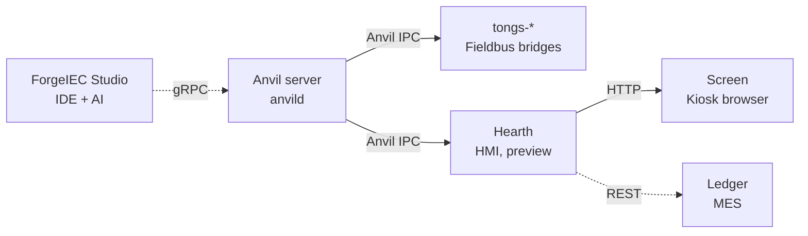

## What the platform delivers

ForgeIEC is a complete platform for industrial automation — from
programming to operation. Current state: **preview version 0.2** (0.2.2),
in pilot operation at the SoLaWi Ackervielfalt. Every component carries the name
of a blacksmith's tool and has a clearly defined remit. Components
are standalone daemons or applications, jointly running over
zero-copy IPC and gRPC.

| | Component | Remit | Status |
|:---:|---|---|---|
|    | **ForgeIEC Studio** | IEC 61131-3 IDE + bus config + AI assistant | ST editor , LD/FBD/SFC  |
|    | **Anvil server (anvild)** | PLC runtime + Anvil bus (iceoryx2) between the processes |  |
|     | **tongs-***         | Fieldbus bridges: Modbus TCP/RTU available, LoRaWAN in progress (focus), EtherCAT / PROFIBUS / EtherNet/IP as skeleton |  |
|    | **Hearth**          | Operator interface (HMI), reads process data directly from the Anvil bus |  |
|    | **Screen**          | Industrial kiosk browser (HMI panel) |  |
|  | **bellowsd**        | OPC-UA / HMI gateway |  |
|    | **Ledger**          | Order management / MES integration |  |

---

## The components

### 🛠️ ForgeIEC Studio — the workbench



Native C++/Qt6 IDE on the workstation (Linux; a Windows build
exists, installer on request). Structured Text (ST) with an own,
object-oriented-capable compiler core is in use; LD, FBD and SFC
are planned for releases 0.3, 0.4 and 0.5
([roadmap](/en/roadmap/)), IL is deprecated. Bus configuration,
live monitor,
oscilloscope, AI assistant built in. Tree-sitter syntax, gRPC link
to anvild, MCP server for LLM tooling.

[Learn more](forge-studio/)

### 🔥 Anvil server (anvild) — the runtime + Anvil bus



Rust/Tokio daemon on the target PLC. Multi-task scheduler with
pthread parallelism, deterministic scan cycles, gRPC listener for
Studio, subprocess manager for the bus bridges.

Built in is **Anvil** — the Anvil bus, a zero-copy shared-memory layer based on iceoryx2, between
runtime, bridges and external subscribers. ABI probe against
type-hash drift; segments of crashed peers are reaped automatically,
without touching live peers. Wire protocol for status, I/O,
diagnostics.

[Learn more](anvil/)

### 🌬️ bellowsd — the bellows




bellowsd is currently **not in development**. The package
`forgeiec-bellows-server` stays in the APT repository but is not
being developed further. Hearth is the intended operator interface.


Designed as an OPC-UA server + Modbus TCP server for HMI
integration: pool variables with the `bellows_export` flag as OPC-UA
nodes + Modbus coils, enabled individually per variable.

[Learn more](bellows/)

### 🔧 tongs-* — the fieldbus tongs



One daemon per protocol. Uniform fault model
(`OK/WARN/FAULT/OFFLINE/UNKNOWN`), FDD-driven diagnostic bits,
Anvil zero-copy IPC to the runtime. Modbus TCP and Modbus RTU are
available; LoRaWAN (wireless sensors for agriculture and wide-area
plants) is in progress and has priority; for EtherCAT, PROFIBUS and
EtherNet/IP the skeleton exists, the protocol itself is in progress.

[Learn more](tongs/)

### 🖥️ Screen — the kiosk browser



CEF-based industrial kiosk browser (Chromium Embedded Framework
+ Rust + winit). Runs fullscreen on HMI panels, opens any web HMI
(Hearth or third-party). Integrated Rocket web server for
settings (network, WireGuard, time zone, 80+ languages), D-Bus
backend for NetworkManager / timedated / localed.

[Learn more](screen/)

### 🏠 Hearth — the forge hearth



Operator interface (HMI), as a preview. Hearth reads the process
data directly from the Anvil bus (iceoryx2, without copying) — the
same path the runtime uses internally; anvild writes the matching
descriptor to `/etc/forgeiec/hearth/descriptor.toml`. Available as
the `forgeiec-hearth-server` package in the APT and RPM repositories.

[Learn more](hearth/)

### 📒 Ledger — the order book



Order management + MES integration. Plans: production orders,
piece-count tracking, traceability (material → batch → product),
shift log, bridge to ERP systems. Planned — comes after Hearth.

[Learn more](ledger/)

---

## How the components fit together

Studio lives on the workstation, everything else on the target
systems. Workstations + target systems can be linked together via
the [team federation model](/en/news/federation-team-trust/) — multiple
workstations see their machines.

---

## Licence, source code and origin

**Licence.** The ForgeIEC tools and services are licensed under
AGPL-3.0-or-later. **Your project belongs to you**: the generated
control code, the runtime API headers and the libanvil library are
licensed under Apache-2.0 — you may build your own closed libraries
on top. If you cannot accept the AGPL, you can obtain a commercial
licence.

The source code is under the AGPL; access on request (enabled via
SSH key, see [Partner](/en/partner/)). Delivery is through signed
packages from an automated CI: a signed APT repository for
Debian/Ubuntu and a signed RPM repository for AlmaLinux 9 and
Fedora 44.

ForgeIEC started as a fork of **OpenPLC** (Thiago Alves); the matiec
compiler was replaced by an own, object-oriented-capable core. The
[founding story](/en/news/die-forgeiec-geschichte/) tells the path.

---

**The tools of the forge.**

blacksmith@forgeiec.io

